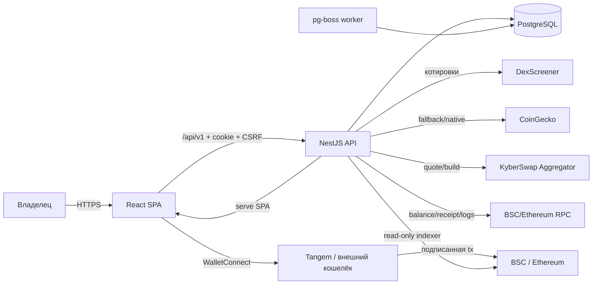
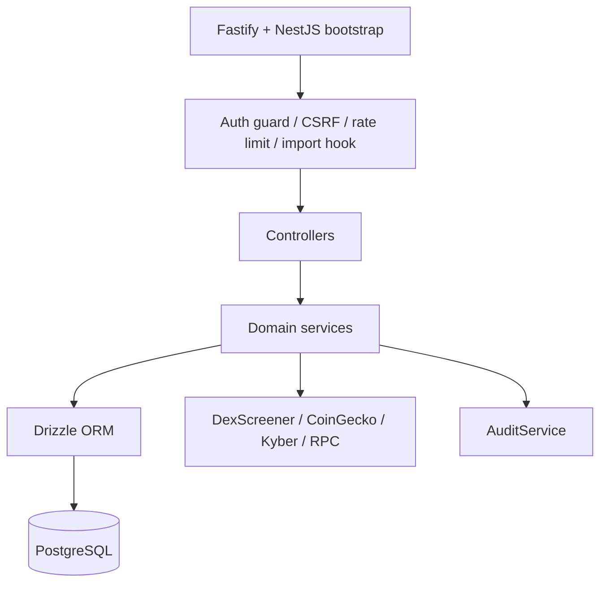
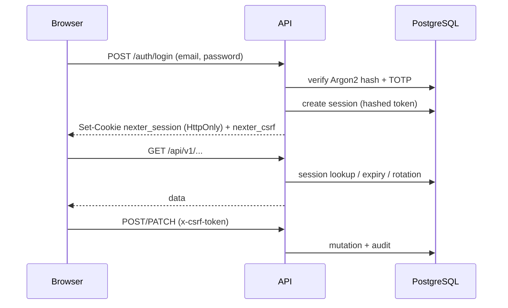
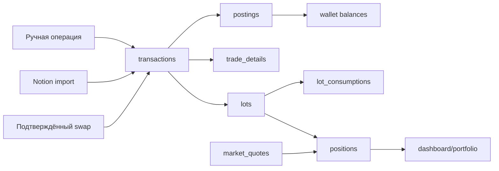
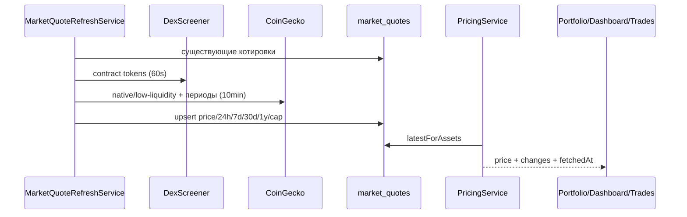
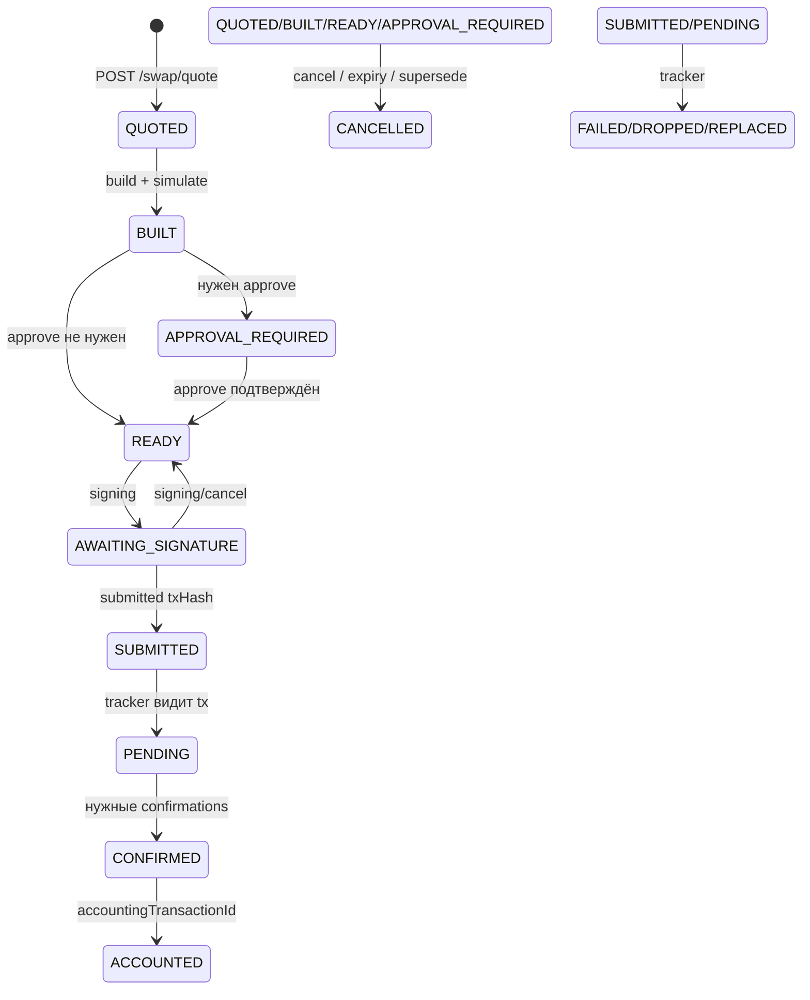
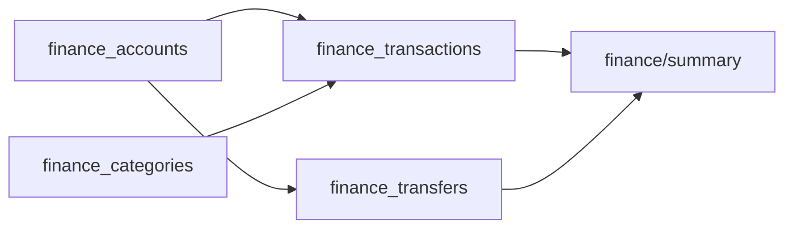
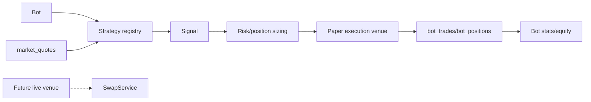

# Архитектура Nexter

## 1. Контекст системы

- **SPA** не хранит приватные ключи и не работает с БД напрямую.
- **API** — единственная точка записи в БД. Он же раздаёт статику SPA из `apps/web/dist`.
- **Worker** выполняет фоновые задачи pg-boss. Сейчас worker использует owner-роль БД, потому что pg-boss создаёт/меняет свою схему; API использует ограниченную роль `nexter_app`.
- **WalletConnect/Tangem** — единственный путь подписи. Сервер не может подписать транзакцию за владельца.
- **RPC/индексер** используется для проверки балансов, квитанций и reconciliation; он не является источником цен.

## 2. Слои API

- **Controllers** только валидируют вход через Zod (`ZodValidationPipe`) и вызывают сервисы.
- **Services** содержат бизнес-логику, транзакции и аудит.
- **Drizzle** используется напрямую; отдельного repository-слоя нет.
- **AuditService** пишет в `audit_log`; для критичных мутаций используется `strict: true` (ошибка аудита откатывает мутацию).
- **Auth guard** проверяет `HttpOnly` cookie-сессию; мутации требуют `x-csrf-token`.
- **Rate limit** — in-memory, по IP; в тестах лимиты выше.

## 3. Аутентификация и сессия

- TOTP обязателен после настройки; step-up TOTP используется для свопов выше `SWAP_STEP_UP_THRESHOLD_USD`.
- Сессии хранятся хэшами; cookie `Secure`/`SameSite` настраиваются окружением.
- Восстановление пароля — через recovery-код; сброс инвалидирует сессии.
- Публичной регистрации нет; первичная настройка — по `SETUP_TOKEN`.

## 4. Учётный контур (ledger)

- Каждая операция создаёт `transactions` + `postings` (двойная запись по счетам).
- Покупка создаёт `lots`; продажа списывает FIFO и создаёт `lot_consumptions` с realized P&L.
- `trade_groups` объединяют лоты/сделки одного актива; `trade_details` хранит reference/execution цены.
- `accounts` бывают `wallet`, `external`, `income`, `expense`, `equity`.
- Кэш-эквиваленты (USDT/USDC) не создают лоты; они учитываются как cash.
- Ручные корректировки (`adjustment`) создают лот по текущей стоимости; отрицательных adjustment в UI нет. Для уменьшения используется withdrawal/продажа.
- Ledger append-only: ошибки исправляются новыми операциями. Технические удаления ошибочных строк допустимы только как аварийная операция с audit-записью и бэкапом.

### 4.1. FIFO

- Лоты сортируются по `acquiredAt, createdAt`.
- Продажа/списание списывает самые старые лоты.
- `remainingAmount`, `remainingCostBasisUsd` обновляются.
- Если лот закрыт не полностью — группа становится `partial`.
- Частичное закрытие сделки передаёт `closeGroupIds` и ожидаемое количество; сервер проверяет остаток.
- Газ/комиссии: капитализируются в cost basis при покупке (если `includeGasInCostBasis`), иначе учитываются как fee.

## 5. Рыночные данные и оценка

- **Приоритет:** DexScreener для контрактных токенов с ликвидностью ≥ `MARKET_QUOTE_MIN_LIQUIDITY_USD` (по умолчанию $25k); CoinGecko — fallback/native.
- `market_quotes.fetched_at` — время последней проверки; `changed_at` — время изменения цены.
- `PricingService.latestForAssets` сначала читает `market_quotes`, затем fallback на manual `prices`.
- 7d/30d/1y и market cap приходят из CoinGecko; у токенов без CoinGecko поля `null`.
- Иконки проксируются через `/api/v1/watchlist/icon` (allowlist CoinGecko hosts), кэш 24ч на сервере + 24ч в браузере; ошибки icon-route — `no-store`.
- 3-месячный период намеренно не показывается: CoinGecko не отдаёт ровно 90 дней.

## 6. Свопы (BSC/Ethereum)

- Quote/build делает KyberSwap; сервер проверяет `amountIn`, router, calldata, selectors, recipient, minOut, executor, fees, deadline.
- `swap_order_close_groups` хранит выбранные группы и ожидаемое количество; сервер проверяет остаток и блокирует параллельные закрытия.
- Подпись — только WalletConnect/Tangem. Сервер не видит ключей.
- После `SUBMITTED` tracker опрашивает RPC, ждёт confirmations, проверяет receipt и создаёт accounting transactions.
- Если hash подписан, но submit не удался — `submit_failed`; повторная отправка использует тот же hash (без второй подписи).
- Если пользователь отклонил запрос, но кошелёк не вернул ошибку, UI позволяет нажать «Отменить ожидание»; подпись возвращается в READY, approval оставляется до ответа/expiry. Если hash всё же придёт, он будет отправлен на сервер.

## 7. Импорт Notion

- Legacy import: загрузка `source.json`, `orders.json`, `transactions.json` (raw Notion rows).
- `preview` парсит и проверяет, `detectExisting` сравнивает существующие лоты/группы, `commit` пишет ledger, `rollback` возможен только для последнего импорта без более поздних операций.
- Исторический 429-order control применяется только к исходному экспорту с numeric ID ≤ 466; более поздние экспорты используют preview totals и per-row detection (ADR 0032).
- `import_rows` хранит staging-строки; audit получает только сводку.
- Notion MCP — внешний инструмент для выгрузки; в репозитории нет токена Notion.

## 8. Финансы (BYN)

- Отдельный модуль, не влияет на крипто-ledger.
- Базовая валюта BYN; USD/EUR счета хранят native balance и курс.
- `credit` — liability; net worth = assets − debt.
- Операции отменяются (soft cancel), не удаляются; отменённые исключены из статистики.
- Импорт — preview/commit/rollback, staging в `finance_import_rows`.

## 9. Задачи, заметки, привычки

- `tasks`: soft archive, recurrence series (`series_id`, `recurrence`, `occurrence_index`), tags, images.
- Recurring update/delete применяется ко всей серии (content/delete); completion — per occurrence.
- `notes`: Markdown subset, soft archive, pin, images/attachments (data URL, 5 × 1.5 MB), notebook journal UI.
- `habits`: name + start date + archive; streak вычисляется в UI/API.
- Все мутации аудируются; тела заметок и ciphertext vault не логируются.

## 10. Vault

- Браузер: PBKDF2-SHA-256 (600k) → master key; случайный AES-256-GCM data key; элементы шифруются data key.
- Сервер хранит salt, iterations, wrapped key, ciphertext, IV; не может расшифровать.
- Мастер-пароль не сохраняется; потеря = потеря vault.
- Vault блокируется при reload; есть manual lock.
- UI: поиск по расшифрованным названию/логину/URL, пароль show/copy, архив/редактирование.

## 11. Reconciliation

- Read-only индексер on-chain transfers; `watched_addresses`, `indexed_transfers`, `reconciliation_runs/items`.
- Сверяет балансы/ledger с chain; не исправляет ledger автоматически.
- `RECONCILIATION_ENABLED` по умолчанию false.
- Data acceptance отложен до clean cutover (ADR 0014).

## 12. Аудит и наблюдаемость

- `audit_log`: action, entity, before/after, ip, userAgent, timestamp.
- Settings → Audit (`/settings/audit`) — просмотр и фильтр.
- `external_api_calls`: провайдер, endpoint, status, latency, errorCode.
- Pino JSON logs: request id, method, url без query, status, responseTime; секреты редактируются.
- Sentry — только safe error context.
- `/health` — liveness; `/ready` — DB readiness.

## 13. Бумажные торговые боты (см. `trading-bots.md`)

- `BotRunnerService` просыпается каждые 60 секунд, берёт advisory lock `nexter:bot-runner` на отдельном соединении и обрабатывает всех `running` ботов.
- Стратегии — код-реестр; параметры валидируются Zod. Paper execution считает комиссию/проскальзывание и пишет только в `bot_*` таблицы.
- `bot_quote_samples` даёт минутную историю для индикаторов; retention 30 дней.
- UI `/testing` показывает full-width карточки, статистику, позиции, сделки и события.
- Ключевое ограничение: реальная автоторговля не может использовать WalletConnect/Tangem без ручного подтверждения. Для live нужен отдельный подписант/session key/AA и отдельный security review; сервер не должен хранить приватные ключи.
