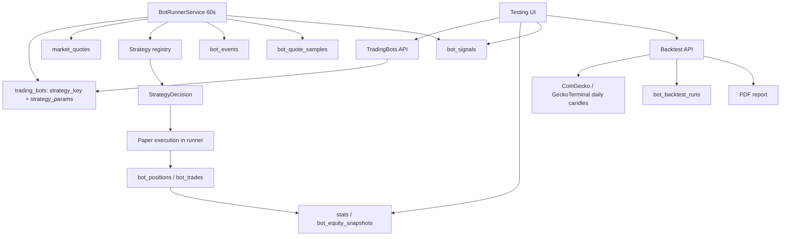

# Trading bots — бумажная торговля и исторический бэктест (UI-38)

> Статус: **UI-37 (упрощение стратегий и диагностика сигналов)** + **UI-38 (исторический бэктест)**. Стратегии — встроенный код, без отдельных экземпляров. Параметры живут в боте. `bot_signals` объясняет решения по каждому токену. `bot_backtest_runs` хранит дневные прогоны, сделки, equity curve и статистику; PDF генерируется по запросу.
>
> Это paper-only система. Реальные свопы, подписи и приватные ключи не используются. Бумажные сделки не пишут в `transactions`/`postings` и не влияют на реальный ledger, отчёты и налоги.

## 1. Что умеет система

- Несколько независимых ботов; у каждого свои токены, бюджет, риск-параметры и параметры выбранной стратегии.
- Боты работают на сервере по минутному тику, даже когда браузер закрыт.
- Виртуальные покупки/продажи по последним `market_quotes` с симулированными комиссией и проскальзыванием.
- Открытые позиции, история сделок, журнал событий, equity curve.
- Статистика: realized/unrealized/total P&L, cash/equity, profit factor, win rate, wins/losses, число сделок, max drawdown.
- Запуск/остановка, сброс бумажного состояния, принудительное закрытие позиций, архивирование.
- Стратегии — встроенный реестр из пяти алгоритмов. Пользователь выбирает стратегию в боте и настраивает её числовые параметры прямо в боте.
- Диагностика: по каждому токену видно последнюю цену, изменение 24 ч, сигнал (`Покупка`/`Продажа`/`Ждёт`), причину и наличие позиции.
- Исторический бэктест: выбор токена и периода (90/180/365 дней), дневной график, анимированные сделки, статистика, PDF-отчёт и журнал прогонов по каждой стратегии.

## 2. Границы v1

- **Paper only.** Нет реальных транзакций и подписей.
- **Long-only spot.** Без шортов, плеча, маржи и деривативов.
- **Minute tick.** Решение раз в 60 секунд по `market_quotes`; цена исполнения — последняя котировка с симулированным slippage.
- **Warm-up.** Индикаторам нужна история `bot_quote_samples`; при первом запуске первые сигналы обычно появляются через 20–30 минут (зависит от окон стратегии).
- **No arbitrary scripts.** Алгоритмы только в коде; параметры валидируются Zod-схемой стратегии.
- **Isolated tables.** `trading_bots`, `bot_*` не связаны с реальным ledger, кроме ссылок на `assets` и `users`.
- **Single tick source.** Цены берутся только из `market_quotes`; отдельного источника цен у ботов нет.
- **Historical backtest uses daily bars.** Внутридневная история и тиковый бэктест не поддерживаются; исполнение — по цене закрытия дня.

## 3. Компоненты



- `TradingBotsService` — CRUD, статистика, диагностика, сброс/закрытие/архив, аудит.
- `BotRunnerService` — интервальный сервис API; advisory lock, минутный тик, paper execution, snapshots, retention, upsert диагностических сигналов.
- `strategies/` — реестр из пяти алгоритмов и общие индикаторы.
- `market_quotes` — единственный источник цены и 24h change.
- `bot_quote_samples` — минутные точки для индикаторов; общие для всех ботов.
- `bot_signals` — последнее решение/причина по каждому токену каждого бота.
- `HistoricalDataService` — дневные свечи из CoinGecko (по `coingeckoId`) или GeckoTerminal (по контракту), кэш на 1 час.
- `BacktestService` / `runBacktest` — прогон стратегии по дневным свечам, статистика и сохранение прогона.
- `BacktestReportService` — PDF на русском через pdfmake/Roboto.

## 4. Модель данных

Все таблицы owner-scoped через `trading_bots.user_id`; дочерние таблицы каскадно удаляются вместе с ботом.

### `trading_bots`

| Поле                                 | Тип           | Смысл                                         |
| ------------------------------------ | ------------- | --------------------------------------------- |
| `id`                                 | uuid          | PK                                            |
| `user_id`                            | uuid          | owner                                         |
| `strategy_key`                       | text          | ключ встроенной стратегии из registry         |
| `strategy_params`                    | jsonb         | валидированные параметры стратегии этого бота |
| `name`                               | text          | unique среди неархивных                       |
| `description`                        | text          |                                               |
| `status`                             | text          | `draft`, `running`, `stopped`                 |
| `budget_usd`                         | numeric(24,8) | стартовый бюджет, неизменяемый после создания |
| `cash_usd`                           | numeric(24,8) | свободный бумажный кэш                        |
| `max_positions`                      | int           | максимум одновременно открытых позиций        |
| `position_size_pct`                  | numeric(5,2)  | % бюджета на одну покупку                     |
| `fee_bps`                            | int           | симулированная комиссия (25 = 25 bps)         |
| `slippage_bps`                       | int           | симулированное проскальзывание (10 = 10 bps)  |
| `max_daily_loss_pct`                 | numeric(5,2)  | дневной лимит реализованного убытка           |
| `cooldown_minutes`                   | int           | пауза между покупками по токену               |
| `peak_equity_usd`                    | numeric(24,8) | пик equity для max drawdown                   |
| `max_drawdown_pct`                   | numeric(5,2)  | максимальная просадка, обновляется runner     |
| `started_at/stopped_at/last_tick_at` | timestamptz   |                                               |
| `archived_at`                        | timestamptz   | soft delete                                   |
| `created_at/updated_at`              | timestamptz   |                                               |

Бюджет — от $100 и кратен $100 (шаг $100). `position_size_pct` — доля **бюджета** на одну покупку, а не доля свободного кэша; grid/DCA могут делать несколько покупок, пока хватает кэша и не достигнут `maxAdds` стратегии.

`strategy_key` обязан существовать в registry при создании, обновлении и запуске. `strategy_params` проверяются Zod-схемой стратегии; неизвестный ключ или невалидные параметры дают `VALIDATION_ERROR`.

### `bot_tokens`

`bot_id`, `asset_id`, `enabled`, `created_at`. `(bot_id, asset_id)` unique. Токены выбираются только из активной Базы токенов (`watchlist`); дубликаты отклоняются. Один токен может быть у нескольких ботов; paper-портфели независимы.

### `bot_positions`

`bot_id`, `asset_id`, `amount numeric(36,18)`, `avg_cost_usd`, `cost_basis_usd`, `opened_at`, `updated_at`. `(bot_id, asset_id)` unique. Учёт по средней цене (average cost), не FIFO. `cost_basis_usd` включает комиссию покупки.

### `bot_trades`

`bot_id`, `asset_id`, `side` (`buy`/`sell`), `amount`, `price_usd`, `usd_value`, `fee_usd`, `slippage_usd`, `realized_pnl_usd`, `reason`, `signal jsonb`, `executed_at`. `price_usd` — фактическая fill-цена с slippage. Для sell `realized_pnl_usd = net proceeds − cost_basis_usd`.

### `bot_equity_snapshots`

`bot_id`, `captured_at`, `cash_usd`, `positions_value_usd`, `equity_usd`, `realized_pnl_usd`, `unrealized_pnl_usd`. Снимок при каждой сделке и не реже одного раза в 5 минут. Retention — 1 год.

### `bot_events`

`bot_id`, `type` (`created`, `started`, `stopped`, `buy`, `sell`, `error`, `reset`, `archived`, `closed_all`), `message`, `payload jsonb`, `created_at`. Retention — 90 дней.

### `bot_quote_samples`

`asset_id`, `price_usd`, `change_24h_pct`, `captured_at`. Одна точка на токен за тик (не чаще 55 секунд), общая для всех ботов. Retention — `BOT_SAMPLE_RETENTION_DAYS` (30 дней по умолчанию). Индексы: `(asset_id, captured_at)` и `(captured_at)` для очистки.

### `bot_signals`

`bot_id`, `asset_id`, `price_usd`, `change_24h_pct`, `action` (`buy`/`sell`/`hold`), `reason`, `has_position`, `updated_at`. `(bot_id, asset_id)` unique; upsert на каждом тике. Это диагностический слой, а не ledger: таблица не влияет на сделки и не заменяет `bot_trades`. Строки создаются по каждому включённому токену, включая случаи «нет котировки», «котировка устарела», «пауза после покупки», «дневной лимит», «достигнут лимит позиций» и «недостаточно кэша». Благодаря этому видно, почему бот с несколькими токенами не торгует по каждому из них.

### `bot_backtest_runs`

| Поле                                  | Тип                     | Смысл                                  |
| ------------------------------------- | ----------------------- | -------------------------------------- |
| `id`                                  | uuid                    | PK                                     |
| `user_id`                             | uuid                    | owner                                  |
| `strategy_key`                        | text                    | ключ встроенной стратегии              |
| `strategy_params`                     | jsonb                   | параметры конкретного прогона          |
| `asset_id`                            | uuid                    | → `assets`                             |
| `days`                                | int                     | запрошенный период                     |
| `source`                              | text                    | `coingecko` / `geckoterminal`          |
| `initial_capital_usd`                 | numeric(24,8)           | стартовый капитал ($1000)              |
| `final_equity_usd`                    | numeric(24,8)           | капитал после принудительного закрытия |
| `total_pnl_usd`                       | numeric(24,8)           | итоговый P&L                           |
| `total_return_pct`                    | numeric(12,4)           | доходность, %                          |
| `gross_profit_usd` / `gross_loss_usd` | numeric(24,8)           | прибыльные/убыточные продажи           |
| `profit_factor`                       | numeric(12,4), nullable | gross profit / gross loss              |
| `win_rate`                            | numeric(12,4), nullable | wins / (wins + losses)                 |
| `trades_count`, `wins`, `losses`      | int                     | счётчики                               |
| `max_drawdown_pct`                    | numeric(12,4)           | максимальная просадка equity           |
| `buy_hold_return_pct`                 | numeric(12,4), nullable | сравнение с удержанием                 |
| `candles`, `trades`, `equity_curve`   | jsonb                   | снимок данных прогона для отчёта       |
| `created_at`                          | timestamptz             | время прогона                          |

Содержимое прогона иммутабельно: API не обновляет свечи/сделки/статистику. Владелец может удалить один прогон или очистить журнал стратегии; удаление аудируется. `nexter_app` имеет `SELECT, INSERT, DELETE`, `UPDATE` отозван. Снимок свечей и сделок хранится вместе с прогоном, поэтому PDF и журнал не зависят от будущих изменений провайдера.

## 5. Стратегии

### 5.1. Интерфейс

```ts
interface StrategyParamField {
  key: string;
  label: string;
  hint?: string;
  min?: number;
  max?: number;
  step?: number;
  unit?: string;
  integer?: boolean;
}

interface StrategyDefinition {
  key: string;
  version: number;
  name: string;
  description: string;
  guide: string;
  bestFor: string;
  risks: string;
  icon: string;
  kind: 'system' | 'custom';
  defaultParams: Record<string, unknown>;
  paramFields: StrategyParamField[];
  parseParams(value: Record<string, unknown>): Record<string, unknown>;
  evaluate(ctx: StrategyContext): StrategyDecision;
}
```

`paramFields` — метаданные для автоматической формы параметров в боте. `guide` — подробное объяснение механики; `bestFor` — когда стратегия уместна; `risks` — основные риски. Всё это показывается в read-only drawer стратегии. `kind` — маркер `Системная`/`Кастомная`; сейчас все пять стратегий системные.

Новая стратегия: файл в `apps/api/src/modules/trading-bots/strategies/`, Zod-схема параметров, `paramFields`, `guide`, регистрация в `strategyDefinitions`, unit-тесты и deploy. UI автоматически покажет новую стратегию.

### 5.2. Встроенные стратегии

| key                 | Название            | Логика входа                              | Логика выхода                                          | Параметры по умолчанию                                  |
| ------------------- | ------------------- | ----------------------------------------- | ------------------------------------------------------ | ------------------------------------------------------- |
| `momentum_breakout` | Импульсный пробой   | fast SMA > slow SMA и 24h change ≥ порога | тейк-профит, стоп-лосс, fast SMA ниже slow SMA         | fast 5, slow 20, minChange24h 1%, TP 5%, SL 3%          |
| `mean_reversion`    | Возврат к среднему  | цена ниже SMA на `entryDropPct`           | возврат к SMA, TP, SL                                  | lookback 20, entryDrop 3%, exitAbove 0.5%, TP 5%, SL 5% |
| `grid_range`        | Сетка в диапазоне   | цена ниже rolling high на шаг сетки       | шаг вверх от средней, SL; докупка на следующей ступени | anchor 20, gridStep 1.5%, maxAdds 4, TP 1.5%, SL 6%     |
| `trend_pullback`    | Откат в тренде      | fast > slow и откат к fast SMA            | TP, SL, пробой тренда                                  | fast 8, slow 30, pullback 1%, TP 5%, SL 3%              |
| `dca_dip`           | Докупка на просадке | цена ниже rolling high на `dipPct`        | TP, SL; докупка до `maxAdds`                           | anchor 20, dip 3%, maxAdds 3, TP 5%, SL 8%              |

Все стратегии long-only и работают по каждому токену независимо. Внутри одного токена цикл всегда `покупка → удержание → продажа`; одновременно можно держать позиции по разным токенам. Общий risk layer в runner: max positions, position size, cash, cooldown, daily loss limit, freshness quote (≤5 минут).

### 5.3. Стратегия vs робот

- **Стратегия** — встроенный алгоритм. Его нельзя создать или изменить из UI. Страница `Стратегии` — read-only справочник с описанием, гайдом, маркером `Системная`/`Кастомная` и параметрами по умолчанию.
- **Робот** — экземпляр со своей стратегией, параметрами, токенами, бюджетом и риск-лимитами. Все настройки стратегии хранятся в `trading_bots.strategy_params`.
- Отдельной сущности «экземпляр стратегии» больше нет. Это убирает лишний слой и позволяет менять параметры одного робота, не затрагивая других.

### 5.4. Paper execution

- **Buy:** `usd = min(budget * positionSizePct / 100, cash)`; `fillPrice = quote * (1 + slippageBps/10000)`; `amount = usd / fillPrice`; `fee = usd * feeBps/10000`; `debit = usd + fee`; cost basis увеличивается на `debit`. Позиция открывается только если `openPositions < maxPositions`; докупка существующей позиции не увеличивает счётчик позиций.
- **Sell:** продаётся вся позиция; `fillPrice = quote * (1 - slippageBps/10000)`; `gross = amount * fillPrice`; `fee = gross * feeBps/10000`; `net = gross - fee`; `realized = net - costBasis`; кэш увеличивается на `net`.
- **Cooldown / пауза после покупки:** блокирует только покупки по токену в течение `cooldownMinutes` после последней покупки; продажи и принудительное закрытие не блокируются.
- **Daily loss:** если реализованный убыток за локальный день ≥ `budget * maxDailyLossPct / 100`, новые покупки блокируются до следующих суток; продажи/стопы продолжают работать.
- **Quote freshness:** котировка старше 5 минут или цена ≤ 0 — токен пропускается на этом тике, причина фиксируется в `bot_signals`.
- **No quote:** токен пропускается; событие `error` не создаётся, причина видна в диагностике.
- **Fee/slippage** записываются в сделку; `slippage_usd` — разница между ценой без slippage и фактической fill-ценой.

### 5.5. Статистика

- `realizedPnlUsd` — сумма `realized_pnl_usd` по sell-сделкам.
- `unrealizedPnlUsd` — сумма `(currentPrice * amount − costBasis)` по открытым позициям; без котировки позиция даёт `null`, в сумму входит 0.
- `equityUsd = cashUsd + positionsValueUsd`.
- `totalPnlUsd = equityUsd − budgetUsd`.
- `grossProfitUsd`/`grossLossUsd` — только по sell-сделкам.
- `profitFactor = grossProfit / grossLoss`; `null`, если убытков не было.
- `winRate = wins / (wins + losses) * 100`; сделки с нулевым P&L не считаются ни победой, ни убытком.
- `maxDrawdownPct` — максимальная просадка; runner обновляет `peak_equity_usd`/`max_drawdown_pct` при каждом snapshot.
- Equity chart в UI запрашивает последние 500 снимков (около 1,7 суток при 5-минутном интервале); all-time P&L и max drawdown при этом сохраняются.
- `tradesCount` включает buy и sell.

### 5.6. Отказ от бота

- **Остановить** — бот перестаёт тикать, открытые позиции и история сохраняются; можно запустить снова.
- **Закрыть позиции** — принудительно продаёт все открытые paper-позиции по последним известным котировкам с учётом комиссии и проскальзывания, фиксирует realized P&L, пишет сделки/события и останавливает бота. История сохраняется.
- **Сбросить** — удаляет paper-позиции, сделки и equity-снимки, возвращает кэш к бюджету. Это «начать заново», а не выход из позиций.
- **Архивировать** — скрывает бота; сервер не разрешает архив, пока есть открытые позиции. Сначала закройте их.
- Бумажные сделки при любом варианте не влияют на реальный ledger.
- Остановка бота и принудительное закрытие позиций создают запись в `notifications`; счётчик непрочитанных виден в главном меню, страница `/notifications` помечает их прочитанными.

## 6. Исторический бэктест

### 6.1. Поток

1. На странице `Стратегии` открыть read-only drawer стратегии.
2. Выбрать токен из активной Базы токенов и период: 30, 90, 180 или 365 дней.
3. Нажать `Начать`: API загружает дневные свечи, кэширует их на час и возвращает график.
4. При необходимости выключить стоп-лосс/тейк-профит, включить реинвестирование или изменить параметры прогона.
5. Нажать `Прогнать`: API прогоняет стратегию по свечам, сохраняет `bot_backtest_runs` и возвращает сделки/статистику.
6. UI показывает сделки на графике по одной (покупательные — синие, прибыльные продажи — зелёные, убыточные — красные), затем карточки статистики и ссылку `Скачать PDF`.
7. Прогон появляется в журнале стратегии; оттуда можно открыть его снова, скачать PDF, удалить один прогон или очистить журнал.

### 6.2. Источник данных

- Если у актива есть `coingecko_id`, используется CoinGecko `GET /coins/{id}/market_chart?vs_currency=usd&days=N`. Ответ группируется по UTC-дням: open/close/high/low из цен дня, volume — сумма `total_volumes` дня.
- Если CoinGecko недоступен или вернул меньше 30 свечей, используется GeckoTerminal: топ-пул токена по `reserve_in_usd`, затем `GET /networks/{network}/pools/{pool}/ohlcv/day`. Сети: `bsc` → `bsc`, `ethereum` → `eth`.
- Минимум 30 дневных свечей; иначе `422` с понятным сообщением.
- Кэш в памяти API: `assetId:days` на 1 час, не более 50 записей. Снимок свечей сохраняется в прогоне, поэтому отчёт воспроизводим.
- Внешние запросы не выполняются в `NODE_ENV=test`; e2e тест наполняет кэш детерминированными свечами.

### 6.3. Движок

- Стартовый капитал — $1000, комиссия 25 bps, проскальзывание 10 bps (как дефолты paper-ботов).
- Один токен, long-only. Вход и выход по сигналам стратегии считаются по закрытию дня и исполняются по этому закрытию с slippage.
- Стоп-лосс и тейк-профит проверяются внутри дня по `low`/`high` свечи: при пересечении порога исполняются по порогу, при гэпе через порог — по цене открытия. Если в одной свече задеты и стоп, и тейк, консервативно считается стоп.
- Размер одной покупки: `initialCapital / maxAdds` (для стратегий без `maxAdds` — весь капитал). При включённом реинвестировании база — текущий equity, а не стартовый капитал. Докупки ограничены `maxAdds` и свободным кэшем.
- Стоп-лосс и тейк-профит можно отключить для конкретного прогона. Отключение убирает только соответствующую ветку выхода (внутридневную защиту и close-based sell), но не блокирует остальные выходы: тейк-профит, `тренд сломан`, возврат к средней и т.п. продолжают работать.
- Позиция учитывается по средней стоимости; `realized = net proceeds − cost basis`.
- В конце периода открытая позиция принудительно закрывается по последнему закрытию с причиной `закрытие в конце периода`.
- Если в выбранном ряду есть пропущенные дни, UI и PDF показывают предупреждение: для низколиквидных токенов GeckoTerminal может отдавать только дни с trades, поэтому стоп/тейк могут сработать с задержкой, а гэп — по открытию следующей свечи.
- Equity curve строится по каждому дню; max drawdown считается по пику equity.
- Статистика: total P&L, return %, gross profit/loss, profit factor, win rate, trades/wins/losses, max drawdown, buy-and-hold return.
- Параметры прогона можно менять в блоке `Параметры прогона`; это не меняет сохранённую стратегию и не влияет на ботов.

### 6.4. PDF и журнал

- `GET /backtests/:id/report.pdf` генерирует PDF на русском (pdfmake + Roboto): тёмный заголовок, карточки метрик, сравнение с buy-and-hold, блок `Исходные условия` (токен, период, источник, пропуски, комиссии, стоп/тейк, реинвестирование, размер покупки), SVG-график equity, параметры с русскими названиями, гайд, таблица сделок и методология. В дисклеймере указано, что стоп/тейк проверяются по high/low, а гэп исполняется по открытию.
- PDF можно скачать для любого сохранённого прогона; содержимое берётся из иммутабельного снимка.
- PDF не хранится: он собирается из снимка прогона при скачивании. Поэтому ссылка в журнале всегда актуальна и не занимает место.
- Журнал `GET /backtests?strategyKey=` owner-scoped и показывает последние 50 прогонов стратегии. Записи иммутабельны.
- Прогон создаёт audit-событие `bot.backtest_created`; сами сделки бэктеста не пишут в `bot_trades` и реальный ledger.

## 7. Runner и надёжность

- `BotRunnerService` стартует через 5 секунд после boot API и затем каждые `BOT_RUNNER_INTERVAL_SECONDS` (60). Для индикаторов загружаются последние 300 минутных samples (покрывает максимальные окна стратегий).
- `BOT_RUNNER_ENABLED=true` по умолчанию; `NODE_ENV=test` отключает интервал.
- Тик защищён session-level Postgres advisory lock `nexter:bot-runner` на отдельном соединении из пула; вторая реплика/второй процесс пропускает тик. Unlock выполняется в `finally`.
- Внутрипроцессный guard `running` предотвращает наложение тиков.
- Ошибка одного бота не останавливает остальных; пишется `bot_events.error`.
- `runOnce()` — публичный метод для тестов/ручного запуска; интервал вызывает его же.
- Retention: samples — `BOT_SAMPLE_RETENTION_DAYS` (30), events — 90 дней, equity — 365 дней. `bot_signals` — bounded by bots × tokens (одна строка на пару), отдельная очистка не нужна.
- При нескольких API-репликах advisory lock предотвращает дубли; per-bot lock не нужен, пока тик один.

## 8. API

Базовый путь: `/api/v1/trading-bots`. Все мутации требуют CSRF и аудируются.

| Метод  | Путь                              | Описание                                                       |
| ------ | --------------------------------- | -------------------------------------------------------------- |
| GET    | `/strategies`                     | read-only список встроенных стратегий (`data`)                 |
| GET    | `/bots?includeArchived=`          | список ботов + статистика                                      |
| POST   | `/bots`                           | создать бота (`strategyKey`, `strategyParams`, токены, бюджет) |
| GET    | `/bots/:id`                       | детали: бот, стратегия, `strategyParams`, токены, позиции      |
| PATCH  | `/bots/:id`                       | настройки; только не-running                                   |
| POST   | `/bots/:id/start`                 | запуск                                                         |
| POST   | `/bots/:id/stop`                  | остановка (позиции сохраняются)                                |
| POST   | `/bots/:id/close-positions`       | закрыть все позиции по текущим котировкам и остановить         |
| POST   | `/bots/:id/reset`                 | сброс paper-состояния к бюджету (история удаляется)            |
| DELETE | `/bots/:id`                       | soft archive (только без открытых позиций)                     |
| GET    | `/bots/:id/trades?limit=&offset=` | сделки (страницы для кнопки `Ещё`)                             |
| GET    | `/bots/:id/events?limit=&offset=` | журнал (страницы для кнопки `Ещё`)                             |
| GET    | `/bots/:id/equity?limit=&offset=` | equity curve                                                   |
| GET    | `/bots/:id/signals`               | диагностика по каждому токену                                  |
| POST   | `/backtests/preview`              | дневные свечи для графика (`assetId`, `days`)                  |
| POST   | `/backtests`                      | прогнать стратегию и сохранить прогон                          |
| GET    | `/backtests?strategyKey=`         | журнал прогонов (owner-scoped, до 100)                         |
| GET    | `/backtests/:id`                  | полный прогон: свечи, сделки, equity curve, статистика         |
| GET    | `/backtests/:id/report.pdf`       | PDF-отчёт по прогону                                           |
| DELETE | `/backtests/:id`                  | удалить один прогон (owner-scoped)                             |
| DELETE | `/backtests?strategyKey=`         | очистить журнал стратегии (owner-scoped)                       |

`/bots/:id/signals` возвращает по каждому токену бота: `assetId`, `symbol`, `name`, `chainCode`, `logoUrl`, `priceUsd`, `change24hPct`, `action`, `reason`, `hasPosition`, `updatedAt`. Если тика ещё не было, `reason = 'Ожидает первого тика'`, `updatedAt = null`.

Ошибки: `VALIDATION_ERROR`, `CONFLICT`, `NOT_FOUND`. Уникальность имени бота — `CONFLICT`. Running-бот нельзя редактировать. Неизвестную стратегию нельзя сохранить или запустить.

Аудит: `bot.created`, `bot.updated`, `bot.started`, `bot.stopped`, `bot.positions_closed`, `bot.reset`, `bot.archived`, `bot.backtest_created`. Бумажные сделки и события живут в `bot_trades`/`bot_events`, а не в `audit_log`. Отдельных аудит-событий для стратегий больше нет: стратегии не изменяются пользователем.

## 9. UI

- **Портфель** (`/portfolio`) содержит табы `Портфель`, `Сделки`, `Роботы`, `Стратегии`.
  - `Роботы` — бумажные роботы: сортировка по P&L/капиталу/профит-фактору, создание/редактирование, карточки с equity/P&L/PF, детальный drawer с сигналами по токенам и журналами.
  - `Стратегии` — read-only справочник: карточки с маркером `Системная`/`Кастомная`; клик открывает drawer с подробным описанием, блоком «Когда лучше использовать», гайдом, рисками и параметрами по умолчанию.
- **Тестирование** (`/testing`) — только автономный тестовый стенд:
  - выбор стратегии (параметры и описание меняются автоматически);
  - поиск токена, период 30/90/180/365;
  - переключатели стоп-лосса/тейк-профита/реинвестирования;
  - `Начать` → спиннер загрузки → адаптивный дневной график (log-шкала, high/low-фитили, процент изменения) → `Прогнать` → сделки появляются на графике (синие покупки, зелёные/красные продажи) → статистика → `Скачать PDF`;
  - журнал прогонов с кнопками `Открыть`, `PDF`, `Удалить`, `Очистить`; первые 20 записей и кнопка `Ещё` до 100.
- Карточка робота кликабельна целиком; кнопки `Настройки`/`Запустить`/`Остановить` не открывают drawer. Для running-бота настройки сначала просят подтверждение и останавливают его; позиции и история сохраняются.
- Журналы бота (сделки и события) отдают по 20 записей; кнопка `Ещё` подгружает следующую страницу через `limit/offset`, а не весь журнал сразу.
- Поиск токенов использует общий client-side helper `apps/web/src/lib/search.ts` (регистронезависимый, `ё = е`, несколько слов через AND). Тот же helper применён в поиске Хранилища и выборе токена для бэктеста.

## 10. Безопасность и границы

- Нет приватных ключей, seed, подписи, WalletConnect и реальных свопов.
- Paper-сделки не создают `transactions`, `postings`, `lots`, `trade_groups`; реальный ledger и налоги не меняются.
- Все запросы owner-scoped; чужие боты недоступны.
- Токены бота должны быть активными записями Базы токенов.
- Стратегии — только код; никакого исполнения пользовательских скриптов.
- Реальная автоторговля невозможна через WalletConnect/Tangem без ручного подтверждения каждой подписи. Для live нужен отдельный подписант/session key/AA, отдельный security review и ADR; сервер не должен хранить приватные ключи.

## 11. Ограничения и будущее

- Минутный тик — не HFT; стоп-лосс срабатывает с задержкой до 60 секунд.
- Paper fill не учитывает глубину пула; slippage фиксированный.
- Токены без котировки/свежести пропускаются; причина видна в `bot_signals`.
- Исторический бэктест — дневные бары, не тиковый/HFT. Он не учитывает глубину пула и внутридневные движения; результаты сравнительные, не гарантия будущей доходности.
- Нет уведомлений вне приложения; журнал событий внутри drawer.
- Будущий live-режим: отдельный `ExecutionVenue` adapter, allowlist, симуляция, лимиты, kill switch, аудит и подписант на стороне владельца. До этого боты остаются paper.

## 12. Проверка

- Unit: `apps/api/src/modules/trading-bots/strategies/strategies.spec.ts` — реестр, `guide`/`kind`/`paramFields`, параметры, buy/sell/hold для пяти стратегий.
- Unit: `apps/api/src/modules/trading-bots/backtest/backtest.engine.spec.ts` — buy/sell-циклы, принудительное закрытие, drawdown, buy-and-hold.
- Unit: `apps/web/src/lib/search.test.ts` — общий поиск (регистр, `ё`, несколько слов).
- UI: журналы бота загружают по 20 записей с `limit/offset`; журнал бэктеста — первые 20 с кнопкой `Ещё`.
- E2E: `apps/api/test/trading-bots.e2e.spec.ts` — read-only стратегии, создание бота с `strategyKey`/`strategyParams`, валидация бюджета, buy/sell по котировкам, статистика, диагностика сигналов, смена стратегии, reset, archive, preview/run/list/PDF бэктеста.
- Перед production: format, typecheck, lint, test, build; backup + restore check; миграции `0034`–`0037`; проверка `/ready` и грантов `nexter_app`.

## 13. Production releases

### UI-24 (2026-11-12)

- Encrypted backup `nexter-2026-11-12-ui24.dump.enc`, restore-check exact match; PR #88 as `f4e806d`; migration `0032`; bundle `assets/index-CJwbitFy.js`.

### UI-37 (2026-11-13)

- Encrypted backup `nexter-2026-11-13-ui37.dump.enc` (plaintext SHA-256 `3494315f…5262c`, encrypted SHA-256 `a4a77de6…354020`). Restore check in `nexter_restore_check_ui37` matched static counts exactly: users 1, assets 49, bots 4, trades 18, events 32, equity 270, notifications 1, cash sum `4009.43372568`; quote samples differed only by live ticks during the check (3406 vs 3409).
- Migrations `0034`–`0035` were first applied to the restored copy. All four bots kept `mean_reversion` and the exact params JSON; `bot_strategies` and `strategy_id` were absent afterwards.
- PR #101 merged as `a627b80`; API deployment `9d70b353-5b00-4222-bdd7-0caca4524af3`; 36 migrations applied; `/ready` 200; bundle `assets/index-eCq4h8AJ.js`.
- Verification: `bot_signals` exists, `nexter_app` has SELECT/INSERT/UPDATE (DELETE revoked in the follow-up migration), existing bots preserved, diagnostics populated for 3 running bots. The owner DB password was rotated during the operation after an internal restore command echoed it; API/worker variables were updated and the worker restarted successfully.
- No real-ledger changes.

### UI-38 (2026-11-13)

- Encrypted backup `nexter-2026-11-13-ui38.dump.enc` (plaintext SHA-256 `5ff6bd67…ae02`, encrypted SHA-256 `0291c6ce…39c1`). Restore check in `nexter_restore_check_ui38` matched static counts: users 1, assets 49, bots 4, trades 22, events 39, notifications 3, signals 9, cash sum `4016.51537404`; equity snapshots and quote samples differed only by live ticks (313/314 and 3841/3844).
- Migration `0036` applied first to the restored copy: `bot_backtest_runs` created, grants `INSERT, SELECT`, `UPDATE/DELETE` absent. Production now has 37 migrations and `bot_signals` grants `INSERT, SELECT, UPDATE` (DELETE revoked).
- PR #102 merged as `df41099`; API deployment `6ab56830-81c5-4c88-baf4-82ef54555185`; `/ready` 200; bundle `assets/index-NW7z5vXx.js`.
- Provider smoke: CoinGecko returned 256 daily candles for `bitway`; GeckoTerminal returned 90 daily candles for CAKE/WBNB. No real-ledger changes.
- UI-40 follow-up: stops/take-profits now execute intrabar by daily high/low (threshold fill, gap at open, stop first). The XNY report that showed −16.8% stop exits was re-run against its stored candles with the corrected engine: stop exits became ≈−3% plus fees/slippage, total return improved from −30.31% to −19.86%, max drawdown from 37.88% to 23.60%. Existing runs stay immutable; new runs use the corrected engine. Production deployment `b352c48e-df1f-4f58-b953-d9174141cff3`, bundle `assets/index-68b2C4tu.js`.

### UI-41 (2026-11-13)

- Encrypted backup `nexter-2026-11-13-ui41.dump.enc` (plaintext SHA-256 `84b42842…2120`, encrypted SHA-256 `a8da1017…e461`). Restore check in `nexter_restore_check_ui41` matched production exactly: users 1, assets 49, bots 4, trades 22, signals 9, backtest runs 31, cash sum `4016.51537404`.
- Migration `0037` was applied first to the restored copy: three boolean option columns exist, DELETE is granted on `bot_backtest_runs`. Production now has 38 migrations; `nexter_app` grants are `SELECT/INSERT/DELETE` on runs (UPDATE revoked) and `SELECT/INSERT/UPDATE` on `bot_signals` (DELETE revoked).
- PR #108 merged as `848e64b9`; API deployment `534e68b1-b064-4dfb-bb96-7445ee16cccf`; `/ready` 200; bundle `assets/index-DJtO_mjB.js`.
- All 31 existing runs were preserved and receive `use_stop_loss=true`, `use_take_profit=true`, `reinvest_profit=false` defaults. No real-ledger changes.

### UI-43 (2026-11-13)

- Fixed exit-flag handling: `stopLossEnabled`/`takeProfitEnabled` are passed into `StrategyContext`, so disabling stop-loss skips only that branch and does not suppress trend-break or other exits.
- An XNY `trend_pullback` report with stop-loss disabled held the 2026-05-17 position until the end of the period, producing a −$2,154.46 loss. The corrected replay exits on the 2026-05-26 trend break for −$879.71 and finishes at +317.58% (vs +187.60%), PF 2.09 (vs 1.86), 18/6 wins/losses (vs 12/2), max drawdown 28.59% (vs 47.15%).
- PDF summary cards now include max drawdown and buy-and-hold. Existing runs remain immutable; new runs use the corrected engine.
- Deployment `e5192250-affc-4049-b68d-826961e6151c`; bundle `assets/index-vYeHY3mT.js`; no migration.

### UI-44 (2026-11-13)

- Strategies are documentation-only; the backtest block moved out of strategy drawers into the standalone `/testing` stand with a strategy selector.
- `/portfolio` now has `Роботы` and `Стратегии` tabs after `Портфель`/`Сделки`; `/testing` contains only the stand.
- Bot trade/event journals load 20 records per request through `limit/offset` and append pages with `Ещё`; the backtest journal starts at 20 and grows to 100.
- Strategy metadata adds `bestFor` and `risks`; the strategy drawer shows description, best-use cases, guide, risks and defaults.
- Deployment `b138c1ea-af5b-4b31-9f9b-cd17c5e87c94`; bundle `assets/index-pQAOvbq_.js`; `/ready` 200. No migration, no real-ledger changes.
