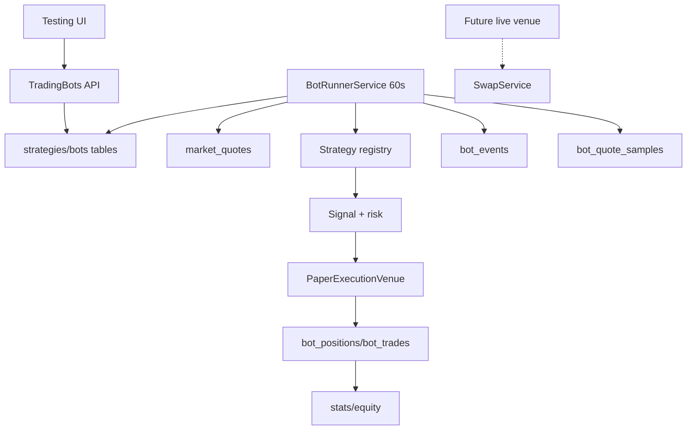

# Trading bots — архитектура тестовой системы (proposed)

> Статус: **design for approval**, не реализовано. Владелец подтвердил: v1 — только бумажная торговля, минутный тик по `market_quotes`, стратегии — встроенный registry с параметрами, бюджет — доля + лимит позиций, токены — из Базы токенов с ценой, без исторического бэктеста.
>
> Следующий шаг после approval: ADR + migration + backend + UI + tests.

## 1. Цель

Дать владельцу полигон для проверки торговых идей без риска и без ручной торговли:

- много ботов, каждый со своей стратегией, бюджетом, списком токенов и риск-параметрами;
- боты работают на сервере по расписанию, даже когда браузер закрыт;
- виртуальные сделки, позиции, P&L, win rate, profit factor, equity curve, события;
- изоляция от реального ledger и реальных свопов;
- архитектурный шов для будущего live execution без переписывания стратегий.

## 2. Границы v1

- **Paper only.** Никаких реальных транзакций, подписей, приватных ключей.
- **Long-only spot.** Без шортов, плеча, маржи и деривативов.
- **Minute tick.** Решения раз в 60 секунд по последним `market_quotes`; исполнение по этой же цене с симулированной комиссией/проскальзыванием.
- **No backtest.** История начинается с запуска бота; исторический бэктест — отдельный будущий этап.
- **No arbitrary scripts.** Алгоритмы — код-определённый registry; владелец создаёт экземпляр стратегии с параметрами. Новая стратегия = код + deploy.
- **Isolated tables.** Бумажные сделки не пишут в `transactions`, `postings`, `lots`, `trade_groups` реального ledger.

## 3. Компоненты



- `BotRunnerService` — интервальный сервис API (60с), с Postgres advisory lock, чтобы не запускать два тика одновременно.
- `StrategyRegistry` — код-реестр стратегий; каждая стратегия имеет `key`, `version`, Zod-схему параметров и `evaluate(context)`.
- `PaperExecutionVenue` — исполнение: цена, slippage, fee, обновление cash/position/trade.
- `BotStatsService` — realized/unrealized, win rate, profit factor, drawdown, equity.
- `BotQuoteSampler` — сохраняет минутные точки только по токенам активных ботов для индикаторов; retention 30 дней.
- `BotEventService` — сигналы/сделки/ошибки/старт/стоп; UI-журнал.

## 4. Данные

### `strategies`

| Поле | Тип | Смысл |
|---|---|---|
| id | uuid | PK |
| userId | uuid | owner |
| key | text | код-ключ (`momentum_breakout`, ...) |
| name | text | имя экземпляра |
| description | text | описание |
| version | int | версия алгоритма |
| params | jsonb | типизированные параметры |
| createdAt/updatedAt | timestamptz | |

`key` должен существовать в registry. `params` валидируется Zod-схемой стратегии. Удаление — soft archive; боты, ссылающиеся на стратегию, блокируются.

### `bots`

| Поле | Тип | Смысл |
|---|---|---|
| id | uuid | PK |
| userId | uuid | owner |
| strategyId | uuid | → strategies |
| name | text | имя |
| description | text | краткое описание |
| status | text | `draft`, `running`, `paused`, `stopped` |
| budgetUsd | numeric | стартовый бюджет |
| cashUsd | numeric | свободный paper cash |
| maxPositions | int | максимум открытых позиций |
| positionSizePct | numeric | % бюджета на сделку |
| feeBps | int | симулированная комиссия |
| slippageBps | int | симулированное проскальзывание |
| maxDailyLossPct | numeric | дневной лимит убытка |
| cooldownMinutes | int | пауза между сделками по токену |
| startedAt/stoppedAt | timestamptz | |
| lastTickAt | timestamptz | |
| createdAt/updatedAt | timestamptz | |

`budgetUsd` неизменяем после первого запуска (или меняется только через reset с подтверждением). `cashUsd` — текущий paper cash. `status` управляет runner.

### `bot_tokens`

`botId`, `assetId`, `enabled`, `maxWeightPct` (optional), `createdAt`. Уникальность `(botId, assetId)`. Токены выбираются из Базы токенов; нужен `market_quotes` с ценой.

### `bot_positions`

`botId`, `assetId`, `amount`, `avgCostUsd`, `costBasisUsd`, `openedAt`, `updatedAt`. Уникальность `(botId, assetId)`. Для v1 — average cost (не FIFO); это paper-учёт, отдельный от реального ledger. Реализованная прибыль считается при sell: `proceeds - costBasis * sold/amount`.

### `bot_trades`

`id`, `botId`, `assetId`, `side` (`buy`/`sell`), `amount`, `priceUsd`, `usdValue`, `feeUsd`, `slippageUsd`, `realizedPnlUsd` (для sell), `reason`, `strategyKey`, `signal` jsonb, `executedAt`.

### `bot_equity_snapshots`

`botId`, `capturedAt`, `cashUsd`, `positionsValueUsd`, `equityUsd`, `realizedPnlUsd`, `unrealizedPnlUsd`. Каждые 5 минут и на каждую сделку; retention 1 год.

### `bot_events`

`botId`, `type` (`started`, `stopped`, `signal`, `buy`, `sell`, `skipped`, `error`, `reset`), `message`, `payload` jsonb, `createdAt`. Retention 90 дней.

### `bot_quote_samples`

`assetId`, `priceUsd`, `change24hPct`, `capturedAt`. Только токены активных ботов; 60с; retention 30 дней; индекс `(assetId, capturedAt)`. Нужен для SMA/RSI/ATR/rolling high.

## 5. Стратегии

### 5.1. Интерфейс

```ts
interface StrategyContext {
  now: Date;
  params: Record<string, unknown>;
  token: { assetId: string; symbol: string; priceUsd: string; change24hPct: string | null };
  history: QuoteSample[];        // 1m samples, oldest → newest
  position: BotPosition | null;
  cashUsd: string;
  budgetUsd: string;
  openPositions: number;
  maxPositions: number;
}

interface StrategyDecision {
  action: 'buy' | 'sell' | 'hold';
  reason: string;
  sizePct?: string;              // override positionSizePct
  stopLossPct?: string;          // risk overlay
  takeProfitPct?: string;
}
```

`StrategyRegistry`:

```ts
interface StrategyDefinition {
  key: string;
  version: number;
  name: string;
  description: string;
  paramsSchema: ZodType;
  evaluate(ctx: StrategyContext): StrategyDecision;
}
```

Новая стратегия добавляется в `apps/api/src/modules/trading-bots/strategies/<key>.ts`, регистрируется в registry, получает тесты и deploy. UI сразу видит её в списке шаблонов.

### 5.2. Стартовый набор (предложение)

| key | Идея | Buy | Sell | Параметры |
|---|---|---|---|---|
| `momentum_breakout` | Пробой/импульс | цена выше SMA(fast), SMA(fast)>SMA(slow), 24h change > threshold | trailing stop / take profit / SMA cross down | fast, slow, minChange24h, takeProfit, stopLoss, trailing |
| `mean_reversion` | Откат к среднему | цена ниже MA/нижней полосы на X%, RSI < oversold | возврат к MA / take profit / stop | lookback, entryDropPct, exitMaPct, stopLoss |
| `grid_range` | Сетка в боковике | цена ниже anchor на N grid steps | цена выше следующего уровня | gridStepPct, levels, rangeFilterPct, maxPositions |
| `trend_pullback` | Покупка отката в тренде | uptrend (fast>slow), pullback к MA, rebound | trailing stop / trend break | fast, slow, pullbackPct, stopLoss |
| `dca_dip` | Докупка на просадке | цена ниже средней/последней покупки на X%, интервал | take profit / stop | dipPct, intervalHours, maxAdds, takeProfit |

Общий risk overlay для всех: stop-loss, take-profit, trailing stop, max daily loss, cooldown, max position %, max open positions, min quote freshness, min liquidity (optional).

### 5.3. Сигналы и исполнение

- На каждом тике для каждого токена бота: получить quote, проверить свежесть (≤5 мин), историю, позицию.
- `evaluate` возвращает `buy/sell/hold`.
- Risk layer может отклонить сигнал (лимиты/cooldown/daily loss).
- Buy: размер = `min(cash, budget * positionSizePct/100, budget/maxPositions)`; цена = quote * (1 + slippage); fee = usd * feeBps/10000; проверить cash.
- Sell: количество = вся позиция или заданная стратегией; цена = quote * (1 - slippage); fee; realized P&L = proceeds - cost basis sold.
- Записывать trade + event + snapshot; обновить cash/position.
- `bot_quote_samples` пишется каждый тик для активных токенов.

## 6. API (proposed)

| Метод | Путь | Описание |
|---|---|---|
| GET | `/trading-bots/strategies` | доступные шаблоны + параметры |
| GET | `/trading-bots/strategies/instances` | созданные стратегии |
| POST | `/trading-bots/strategies` | создать экземпляр (key/name/description/params) |
| PATCH | `/trading-bots/strategies/:id` | изменить |
| DELETE | `/trading-bots/strategies/:id` | архив (если нет running bots) |
| GET | `/trading-bots` | список ботов + summary |
| POST | `/trading-bots` | создать |
| PATCH | `/trading-bots/:id` | настройки (только draft/paused) |
| POST | `/trading-bots/:id/start` | запуск |
| POST | `/trading-bots/:id/stop` | пауза/стоп (сохраняет позиции) |
| POST | `/trading-bots/:id/reset` | сброс paper-состояния (с подтверждением) |
| GET | `/trading-bots/:id` | детали |
| GET | `/trading-bots/:id/positions` | открытые позиции |
| GET | `/trading-bots/:id/trades` | сделки |
| GET | `/trading-bots/:id/equity` | equity curve |
| GET | `/trading-bots/:id/events` | журнал |

Все мутации аудируются (`bot.created`, `bot.started`, `bot.stopped`, `bot.updated`, `bot.reset`). Trades/events — отдельные таблицы, не audit.

## 7. UI

- Новый top-level пункт **Тестирование** (иконка робота/графика).
- Внутри два таба: **Боты** и **Стратегии**.
- Боты — full-width cards (как База токенов): name, strategy, status chip, fan while running, budget/equity/P&L, open positions, win rate/profit factor, start/stop.
- Клик по карточке — боковой drawer (third width) или страница: summary, equity chart, open positions, trades, events, settings.
- Создание: name, description, strategy instance, tokens from База токенов (multi-select), budget, max positions, position size %, fee/slippage, risk limits.
- Стратегии: cards with name/description/parameters; create from template; edit params; archive.
- Fan: same `LiveRefreshIndicator` visual language; spins while bot runner is ticking/query fetching.
- Russian copy, USD.

## 8. Scheduler и надёжность

- `BotRunnerService` запускается через 5с после boot, затем каждые 60с.
- Глобальный Postgres advisory lock `nexter:bot-runner`; если lock занят — пропустить тик.
- Per-bot advisory lock или `FOR UPDATE SKIP LOCKED` при обработке.
- `BOT_RUNNER_ENABLED` (default true) и `BOT_RUNNER_INTERVAL_SECONDS` (60).
- Ошибка одного бота не останавливает остальных; писать `bot_events.error` и продолжать.
- Если quote отсутствует/старше 5 мин — skip с событием.
- Если bot.status != running — skip.
- Runtime guard: если тик занял > interval, следующий пропускается (in-process flag + advisory lock).
- При нескольких API-репликах advisory lock предотвращает дубли; для per-bot обработки использовать `SELECT ... FOR UPDATE SKIP LOCKED`.

## 9. Live execution (future)

`ExecutionVenue`:

```ts
interface ExecutionVenue {
  kind: 'paper' | 'live';
  buy(input): Promise<ExecutionFill>;
  sell(input): Promise<ExecutionFill>;
}
```

v1 — `PaperExecutionVenue`. Future live — adapter to `SwapService`/Kyber, но **WalletConnect/Tangem требует ручного подтверждения каждой транзакции**. Полная автоторговля невозможна без:

- локального подписанта на машине владельца;
- smart-account/session key с ограниченными правами;
- отдельного кастодиального signer-сервиса (противоречит правилу «no private keys on server»).

Поэтому live-режим — отдельный security review и ADR. До него боты остаются paper.

## 10. Статистика

Для каждого бота:

- equity, cash, positions value;
- realized/unrealized/total P&L;
- total profit, total loss, profit factor;
- win rate, wins/losses, trade count;
- max drawdown, best/worst trade;
- per-token P&L и exposure;
- equity curve (5-минутные snapshots + сделки);
- active positions с текущей ценой и P&L.

## 11. Ограничения и риски

- Minute tick по `market_quotes` — не HFT; стоп-лосс сработает с задержкой до 60с.
- Paper fill по последней цене не учитывает реальную глубину стакана; slippage фиксированный.
- Токены без ликвидности/цены пропускаются.
- `bot_quote_samples` растут; retention/prune обязателен.
- Стратегии — код; новые идеи требуют deploy.
- Live-торговля требует отдельного подписанта; не добавлять приватные ключи на сервер.
- Боты не влияют на реальный ledger/налоги/отчёты.

## 12. Что нужно подтвердить перед реализацией

1. Стартовый набор стратегий (5 выше) — ок или добавить/убрать?
2. Размер бюджета по умолчанию (предлагаю $1,000 на бота) и минимальный шаг.
3. Комиссия/проскальзывание по умолчанию (предлагаю 25 bps fee + 10 bps slippage).
4. Разрешать ли несколько ботов на один токен (да, независимые paper-портфели).
5. Нужен ли `reset` paper-состояния (обнулить историю/бюджет) или только stop/start.
6. Нужны ли уведомления о сделках/ошибках в интерфейсе (badge/журнал) — предлагаю журнал событий.
