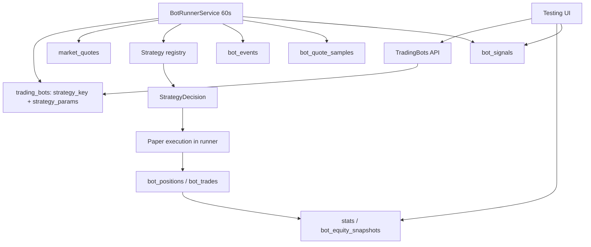

# Trading bots — бумажная торговля (UI-37)

> Статус: **UI-37 (упрощение стратегий и диагностика сигналов)**. Стратегии — встроенный код, без отдельных экземпляров. Параметры живут в боте. Добавлена таблица `bot_signals` для диагностики по каждому токену.
>
> Это paper-only система. Реальные свопы, подписи и приватные ключи не используются. Бумажные сделки не пишут в `transactions`/`postings` и не влияют на реальный ledger, отчёты и налоги.

## 1. Что умеет система

- Несколько независимых ботов; у каждого свои токены, бюджет, риск-параметры и параметры выбранной стратегии.
- Боты работают на сервере по минутному тику, даже когда браузер закрыт.
- Виртуальные покупки/продажи по последним `market_quotes` с симулированными комиссией и проскальзыванием.
- Открытые позиции, история сделок, журнал событий, equity curve.
- Статистика: realized/unrealized/total P&L, cash/equity, profit factor, win rate, wins/losses, число сделок, max drawdown.
- Запуск/остановка, сброс бумажного состояния, принудительное закрытие позиций, архивирование.
- Стратегии — встроенный реестр из пяти алгоритмов. Пользователь выбирает стратегию в боте и настраивает её числовые параметры прямо в боте.
- Диагностика: по каждому токену видно последнюю цену, изменение 24 ч, сигнал (`Покупка`/`Продажа`/`Ждёт`), причину и наличие позиции.

## 2. Границы v1

- **Paper only.** Нет реальных транзакций и подписей.
- **Long-only spot.** Без шортов, плеча, маржи и деривативов.
- **Minute tick.** Решение раз в 60 секунд по `market_quotes`; цена исполнения — последняя котировка с симулированным slippage.
- **Warm-up.** Индикаторам нужна история `bot_quote_samples`; при первом запуске первые сигналы обычно появляются через 20–30 минут (зависит от окон стратегии).
- **No arbitrary scripts.** Алгоритмы только в коде; параметры валидируются Zod-схемой стратегии.
- **Isolated tables.** `trading_bots`, `bot_*` не связаны с реальным ledger, кроме ссылок на `assets` и `users`.
- **Single tick source.** Цены берутся только из `market_quotes`; отдельного источника цен у ботов нет.
- **No historical backtest yet.** Исторический прогон — следующий этап (UI-38).

## 3. Компоненты



- `TradingBotsService` — CRUD, статистика, диагностика, сброс/закрытие/архив, аудит.
- `BotRunnerService` — интервальный сервис API; advisory lock, минутный тик, paper execution, snapshots, retention, upsert диагностических сигналов.
- `strategies/` — реестр из пяти алгоритмов и общие индикаторы.
- `market_quotes` — единственный источник цены и 24h change.
- `bot_quote_samples` — минутные точки для индикаторов; общие для всех ботов.
- `bot_signals` — последнее решение/причина по каждому токену каждого бота.

## 4. Модель данных

Все таблицы owner-scoped через `trading_bots.user_id`; дочерние таблицы каскадно удаляются вместе с ботом.

### `trading_bots`

| Поле                                 | Тип           | Смысл                                         |
| ------------------------------------ | ------------- | --------------------------------------------- |
| `id`                                 | uuid          | PK                                            |
| `user_id`                            | uuid          | owner                                         |
| `strategy_key`                       | text          | ключ встроенной стратегии из registry         |
| `strategy_params`                    | jsonb         | валидированные параметры стратегии этого бота |
| `name`                               | text          | unique среди неархивных                       |
| `description`                        | text          |                                               |
| `status`                             | text          | `draft`, `running`, `stopped`                 |
| `budget_usd`                         | numeric(24,8) | стартовый бюджет, неизменяемый после создания |
| `cash_usd`                           | numeric(24,8) | свободный бумажный кэш                        |
| `max_positions`                      | int           | максимум одновременно открытых позиций        |
| `position_size_pct`                  | numeric(5,2)  | % бюджета на одну покупку                     |
| `fee_bps`                            | int           | симулированная комиссия (25 = 25 bps)         |
| `slippage_bps`                       | int           | симулированное проскальзывание (10 = 10 bps)  |
| `max_daily_loss_pct`                 | numeric(5,2)  | дневной лимит реализованного убытка           |
| `cooldown_minutes`                   | int           | пауза между покупками по токену               |
| `peak_equity_usd`                    | numeric(24,8) | пик equity для max drawdown                   |
| `max_drawdown_pct`                   | numeric(5,2)  | максимальная просадка, обновляется runner     |
| `started_at/stopped_at/last_tick_at` | timestamptz   |                                               |
| `archived_at`                        | timestamptz   | soft delete                                   |
| `created_at/updated_at`              | timestamptz   |                                               |

Бюджет — от $100 и кратен $100 (шаг $100). `position_size_pct` — доля **бюджета** на одну покупку, а не доля свободного кэша; grid/DCA могут делать несколько покупок, пока хватает кэша и не достигнут `maxAdds` стратегии.

`strategy_key` обязан существовать в registry при создании, обновлении и запуске. `strategy_params` проверяются Zod-схемой стратегии; неизвестный ключ или невалидные параметры дают `VALIDATION_ERROR`.

### `bot_tokens`

`bot_id`, `asset_id`, `enabled`, `created_at`. `(bot_id, asset_id)` unique. Токены выбираются только из активной Базы токенов (`watchlist`); дубликаты отклоняются. Один токен может быть у нескольких ботов; paper-портфели независимы.

### `bot_positions`

`bot_id`, `asset_id`, `amount numeric(36,18)`, `avg_cost_usd`, `cost_basis_usd`, `opened_at`, `updated_at`. `(bot_id, asset_id)` unique. Учёт по средней цене (average cost), не FIFO. `cost_basis_usd` включает комиссию покупки.

### `bot_trades`

`bot_id`, `asset_id`, `side` (`buy`/`sell`), `amount`, `price_usd`, `usd_value`, `fee_usd`, `slippage_usd`, `realized_pnl_usd`, `reason`, `signal jsonb`, `executed_at`. `price_usd` — фактическая fill-цена с slippage. Для sell `realized_pnl_usd = net proceeds − cost_basis_usd`.

### `bot_equity_snapshots`

`bot_id`, `captured_at`, `cash_usd`, `positions_value_usd`, `equity_usd`, `realized_pnl_usd`, `unrealized_pnl_usd`. Снимок при каждой сделке и не реже одного раза в 5 минут. Retention — 1 год.

### `bot_events`

`bot_id`, `type` (`created`, `started`, `stopped`, `buy`, `sell`, `error`, `reset`, `archived`, `closed_all`), `message`, `payload jsonb`, `created_at`. Retention — 90 дней.

### `bot_quote_samples`

`asset_id`, `price_usd`, `change_24h_pct`, `captured_at`. Одна точка на токен за тик (не чаще 55 секунд), общая для всех ботов. Retention — `BOT_SAMPLE_RETENTION_DAYS` (30 дней по умолчанию). Индексы: `(asset_id, captured_at)` и `(captured_at)` для очистки.

### `bot_signals`

`bot_id`, `asset_id`, `price_usd`, `change_24h_pct`, `action` (`buy`/`sell`/`hold`), `reason`, `has_position`, `updated_at`. `(bot_id, asset_id)` unique; upsert на каждом тике. Это диагностический слой, а не ledger: таблица не влияет на сделки и не заменяет `bot_trades`. Строки создаются по каждому включённому токену, включая случаи «нет котировки», «котировка устарела», «пауза после покупки», «дневной лимит», «достигнут лимит позиций» и «недостаточно кэша». Благодаря этому видно, почему бот с несколькими токенами не торгует по каждому из них.

## 5. Стратегии

### 5.1. Интерфейс

```ts
interface StrategyParamField {
  key: string;
  label: string;
  hint?: string;
  min?: number;
  max?: number;
  step?: number;
  unit?: string;
  integer?: boolean;
}

interface StrategyDefinition {
  key: string;
  version: number;
  name: string;
  description: string;
  guide: string;
  icon: string;
  kind: 'system' | 'custom';
  defaultParams: Record<string, unknown>;
  paramFields: StrategyParamField[];
  parseParams(value: Record<string, unknown>): Record<string, unknown>;
  evaluate(ctx: StrategyContext): StrategyDecision;
}
```

`paramFields` — метаданные для автоматической формы параметров в боте. `guide` — краткое объяснение для read-only drawer стратегии. `kind` — маркер `Системная`/`Кастомная`; сейчас все пять стратегий системные.

Новая стратегия: файл в `apps/api/src/modules/trading-bots/strategies/`, Zod-схема параметров, `paramFields`, `guide`, регистрация в `strategyDefinitions`, unit-тесты и deploy. UI автоматически покажет новую стратегию.

### 5.2. Встроенные стратегии

| key                 | Название            | Логика входа                              | Логика выхода                                          | Параметры по умолчанию                                  |
| ------------------- | ------------------- | ----------------------------------------- | ------------------------------------------------------ | ------------------------------------------------------- |
| `momentum_breakout` | Импульсный пробой   | fast SMA > slow SMA и 24h change ≥ порога | тейк-профит, стоп-лосс, fast SMA ниже slow SMA         | fast 5, slow 20, minChange24h 1%, TP 5%, SL 3%          |
| `mean_reversion`    | Возврат к среднему  | цена ниже SMA на `entryDropPct`           | возврат к SMA, TP, SL                                  | lookback 20, entryDrop 3%, exitAbove 0.5%, TP 5%, SL 5% |
| `grid_range`        | Сетка в диапазоне   | цена ниже rolling high на шаг сетки       | шаг вверх от средней, SL; докупка на следующей ступени | anchor 20, gridStep 1.5%, maxAdds 4, TP 1.5%, SL 6%     |
| `trend_pullback`    | Откат в тренде      | fast > slow и откат к fast SMA            | TP, SL, пробой тренда                                  | fast 8, slow 30, pullback 1%, TP 5%, SL 3%              |
| `dca_dip`           | Докупка на просадке | цена ниже rolling high на `dipPct`        | TP, SL; докупка до `maxAdds`                           | anchor 20, dip 3%, maxAdds 3, TP 5%, SL 8%              |

Все стратегии long-only и работают по каждому токену независимо. Внутри одного токена цикл всегда `покупка → удержание → продажа`; одновременно можно держать позиции по разным токенам. Общий risk layer в runner: max positions, position size, cash, cooldown, daily loss limit, freshness quote (≤5 минут).

### 5.3. Стратегия vs робот

- **Стратегия** — встроенный алгоритм. Его нельзя создать или изменить из UI. Страница `Стратегии` — read-only справочник с описанием, гайдом, маркером `Системная`/`Кастомная` и параметрами по умолчанию.
- **Робот** — экземпляр со своей стратегией, параметрами, токенами, бюджетом и риск-лимитами. Все настройки стратегии хранятся в `trading_bots.strategy_params`.
- Отдельной сущности «экземпляр стратегии» больше нет. Это убирает лишний слой и позволяет менять параметры одного робота, не затрагивая других.

### 5.4. Paper execution

- **Buy:** `usd = min(budget * positionSizePct / 100, cash)`; `fillPrice = quote * (1 + slippageBps/10000)`; `amount = usd / fillPrice`; `fee = usd * feeBps/10000`; `debit = usd + fee`; cost basis увеличивается на `debit`. Позиция открывается только если `openPositions < maxPositions`; докупка существующей позиции не увеличивает счётчик позиций.
- **Sell:** продаётся вся позиция; `fillPrice = quote * (1 - slippageBps/10000)`; `gross = amount * fillPrice`; `fee = gross * feeBps/10000`; `net = gross - fee`; `realized = net - costBasis`; кэш увеличивается на `net`.
- **Cooldown / пауза после покупки:** блокирует только покупки по токену в течение `cooldownMinutes` после последней покупки; продажи и принудительное закрытие не блокируются.
- **Daily loss:** если реализованный убыток за локальный день ≥ `budget * maxDailyLossPct / 100`, новые покупки блокируются до следующих суток; продажи/стопы продолжают работать.
- **Quote freshness:** котировка старше 5 минут или цена ≤ 0 — токен пропускается на этом тике, причина фиксируется в `bot_signals`.
- **No quote:** токен пропускается; событие `error` не создаётся, причина видна в диагностике.
- **Fee/slippage** записываются в сделку; `slippage_usd` — разница между ценой без slippage и фактической fill-ценой.

### 5.5. Статистика

- `realizedPnlUsd` — сумма `realized_pnl_usd` по sell-сделкам.
- `unrealizedPnlUsd` — сумма `(currentPrice * amount − costBasis)` по открытым позициям; без котировки позиция даёт `null`, в сумму входит 0.
- `equityUsd = cashUsd + positionsValueUsd`.
- `totalPnlUsd = equityUsd − budgetUsd`.
- `grossProfitUsd`/`grossLossUsd` — только по sell-сделкам.
- `profitFactor = grossProfit / grossLoss`; `null`, если убытков не было.
- `winRate = wins / (wins + losses) * 100`; сделки с нулевым P&L не считаются ни победой, ни убытком.
- `maxDrawdownPct` — максимальная просадка; runner обновляет `peak_equity_usd`/`max_drawdown_pct` при каждом snapshot.
- Equity chart в UI запрашивает последние 500 снимков (около 1,7 суток при 5-минутном интервале); all-time P&L и max drawdown при этом сохраняются.
- `tradesCount` включает buy и sell.

### 5.6. Отказ от бота

- **Остановить** — бот перестаёт тикать, открытые позиции и история сохраняются; можно запустить снова.
- **Закрыть позиции** — принудительно продаёт все открытые paper-позиции по последним известным котировкам с учётом комиссии и проскальзывания, фиксирует realized P&L, пишет сделки/события и останавливает бота. История сохраняется.
- **Сбросить** — удаляет paper-позиции, сделки и equity-снимки, возвращает кэш к бюджету. Это «начать заново», а не выход из позиций.
- **Архивировать** — скрывает бота; сервер не разрешает архив, пока есть открытые позиции. Сначала закройте их.
- Бумажные сделки при любом варианте не влияют на реальный ledger.
- Остановка бота и принудительное закрытие позиций создают запись в `notifications`; счётчик непрочитанных виден в главном меню, страница `/notifications` помечает их прочитанными.

## 6. Runner и надёжность

- `BotRunnerService` стартует через 5 секунд после boot API и затем каждые `BOT_RUNNER_INTERVAL_SECONDS` (60). Для индикаторов загружаются последние 300 минутных samples (покрывает максимальные окна стратегий).
- `BOT_RUNNER_ENABLED=true` по умолчанию; `NODE_ENV=test` отключает интервал.
- Тик защищён session-level Postgres advisory lock `nexter:bot-runner` на отдельном соединении из пула; вторая реплика/второй процесс пропускает тик. Unlock выполняется в `finally`.
- Внутрипроцессный guard `running` предотвращает наложение тиков.
- Ошибка одного бота не останавливает остальных; пишется `bot_events.error`.
- `runOnce()` — публичный метод для тестов/ручного запуска; интервал вызывает его же.
- Retention: samples — `BOT_SAMPLE_RETENTION_DAYS` (30), events — 90 дней, equity — 365 дней. `bot_signals` — bounded by bots × tokens (одна строка на пару), отдельная очистка не нужна.
- При нескольких API-репликах advisory lock предотвращает дубли; per-bot lock не нужен, пока тик один.

## 7. API

Базовый путь: `/api/v1/trading-bots`. Все мутации требуют CSRF и аудируются.

| Метод  | Путь                        | Описание                                                       |
| ------ | --------------------------- | -------------------------------------------------------------- |
| GET    | `/strategies`               | read-only список встроенных стратегий (`data`)                 |
| GET    | `/bots?includeArchived=`    | список ботов + статистика                                      |
| POST   | `/bots`                     | создать бота (`strategyKey`, `strategyParams`, токены, бюджет) |
| GET    | `/bots/:id`                 | детали: бот, стратегия, `strategyParams`, токены, позиции      |
| PATCH  | `/bots/:id`                 | настройки; только не-running                                   |
| POST   | `/bots/:id/start`           | запуск                                                         |
| POST   | `/bots/:id/stop`            | остановка (позиции сохраняются)                                |
| POST   | `/bots/:id/close-positions` | закрыть все позиции по текущим котировкам и остановить         |
| POST   | `/bots/:id/reset`           | сброс paper-состояния к бюджету (история удаляется)            |
| DELETE | `/bots/:id`                 | soft archive (только без открытых позиций)                     |
| GET    | `/bots/:id/trades?limit=`   | сделки                                                         |
| GET    | `/bots/:id/events?limit=`   | журнал                                                         |
| GET    | `/bots/:id/equity?limit=`   | equity curve                                                   |
| GET    | `/bots/:id/signals`         | диагностика по каждому токену                                  |

`/bots/:id/signals` возвращает по каждому токену бота: `assetId`, `symbol`, `name`, `chainCode`, `logoUrl`, `priceUsd`, `change24hPct`, `action`, `reason`, `hasPosition`, `updatedAt`. Если тика ещё не было, `reason = 'Ожидает первого тика'`, `updatedAt = null`.

Ошибки: `VALIDATION_ERROR`, `CONFLICT`, `NOT_FOUND`. Уникальность имени бота — `CONFLICT`. Running-бот нельзя редактировать. Неизвестную стратегию нельзя сохранить или запустить.

Аудит: `bot.created`, `bot.updated`, `bot.started`, `bot.stopped`, `bot.positions_closed`, `bot.reset`, `bot.archived`. Бумажные сделки и события живут в `bot_trades`/`bot_events`, а не в `audit_log`. Отдельных аудит-событий для стратегий больше нет: стратегии не изменяются пользователем.

## 8. UI

- Top-level пункт **Тестирование** внутри Crypto (`/testing`).
- Табы **Роботы** и **Стратегии**; рядом с `Роботы` — табы сортировки **По P&L**, **По капиталу**, **По профит-фактору**. Глобального индикатора «Роботы работают» нет: состояние видно на каждой карточке.
- Карточка робота кликабельна целиком (мышь, Enter/Space); кнопки `Настройки`/`Запустить`/`Остановить` не открывают drawer. Сортировка по P&L/капиталу/профит-фактору применяется к списку.
- Создание/редактирование: имя, описание, встроенная стратегия, авто-форма её параметров, токены из Базы токенов с поиском по символу/названию/сети, бюджет $1000 с шагом $100, max positions, position size %, fee/slippage bps, daily loss %, cooldown.
- Drawer бота: equity chart, токены, **сигналы стратегии по токенам** (цена, 24 ч, сигнал, причина, позиция, время), настройки, параметры стратегии, открытые позиции, сделки, журнал, кнопка `Изменить`, start/stop/reset/close/archive.
- Стратегии: read-only карточки с маркером `Системная`/`Кастомная`; клик открывает drawer с описанием, гайдом и параметрами по умолчанию. Создания/редактирования/архива стратегий нет.
- Поиск токенов использует общий client-side helper `apps/web/src/lib/search.ts` (регистронезависимый, `ё = е`, несколько слов через AND). Тот же helper применён в поиске Хранилища.

## 9. Безопасность и границы

- Нет приватных ключей, seed, подписи, WalletConnect и реальных свопов.
- Paper-сделки не создают `transactions`, `postings`, `lots`, `trade_groups`; реальный ledger и налоги не меняются.
- Все запросы owner-scoped; чужие боты недоступны.
- Токены бота должны быть активными записями Базы токенов.
- Стратегии — только код; никакого исполнения пользовательских скриптов.
- Реальная автоторговля невозможна через WalletConnect/Tangem без ручного подтверждения каждой подписи. Для live нужен отдельный подписант/session key/AA, отдельный security review и ADR; сервер не должен хранить приватные ключи.

## 10. Ограничения и будущее

- Минутный тик — не HFT; стоп-лосс срабатывает с задержкой до 60 секунд.
- Paper fill не учитывает глубину пула; slippage фиксированный.
- Токены без котировки/свежести пропускаются; причина видна в `bot_signals`.
- Нет исторического бэктеста в этой итерации; equity curve начинается с запуска. Бэктест по дневным барам, график со сделками, PDF-отчёт и журнал прогонов — UI-38.
- Нет уведомлений вне приложения; журнал событий внутри drawer.
- Будущий live-режим: отдельный `ExecutionVenue` adapter, allowlist, симуляция, лимиты, kill switch, аудит и подписант на стороне владельца. До этого боты остаются paper.

## 11. Проверка

- Unit: `apps/api/src/modules/trading-bots/strategies/strategies.spec.ts` — реестр, `guide`/`kind`/`paramFields`, параметры, buy/sell/hold для пяти стратегий.
- Unit: `apps/web/src/lib/search.test.ts` — общий поиск (регистр, `ё`, несколько слов).
- E2E: `apps/api/test/trading-bots.e2e.spec.ts` — read-only стратегии, создание бота с `strategyKey`/`strategyParams`, валидация бюджета, buy/sell по котировкам, статистика, диагностика сигналов, смена стратегии, reset, archive.
- Перед production: format, typecheck, lint, test, build; backup + restore check; миграции `0034`–`0035`; проверка `/ready` и грантов `nexter_app`.

## 12. Production releases

### UI-24 (2026-11-12)

- Encrypted backup `nexter-2026-11-12-ui24.dump.enc`, restore-check exact match; PR #88 as `f4e806d`; migration `0032`; bundle `assets/index-CJwbitFy.js`.

### UI-37 (в процессе, 2026-11-13)

- Migration `0034` adds `bot_signals`, `trading_bots.strategy_key`/`strategy_params`, and backfills values from `bot_strategies` before the old table is removed.
- Migration `0035` drops the `strategy_id` FK/column and the `bot_strategies` table after the backfill.
- API/UI change is frontend + API only; no real-ledger changes.
